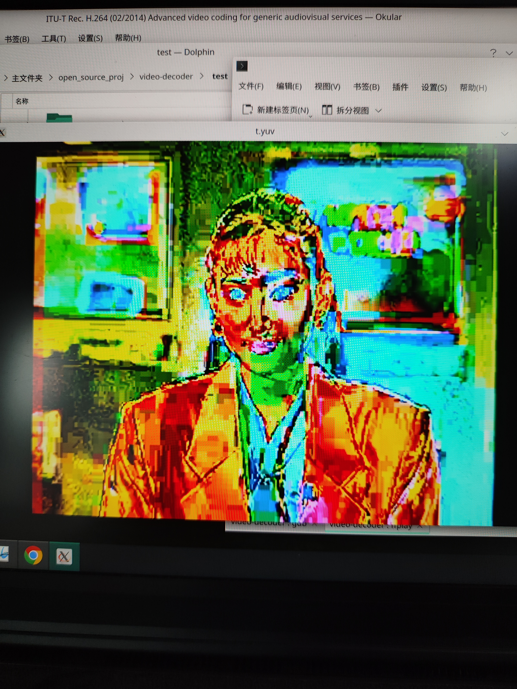

# h264 decoder
一个个人学习研究用的h264解码器.

## 完成状态
- 实现frame mode下的h264解码
  - field mode(PAFF、MBAFF)均未考虑
- 实现CAVLC entropy decoding
  - CABAC未实现
- 实现4:2:0格式
  - 4:2:2和4:4:4未实现
- Intra
  - 实现16x16和4x4预测
  - 8x8预测未实现
  - 实现IPCM预测，但没有测试过带有该类型的码流
- Inter P
  - 块大小16x16到4x4均实现
  - 实现P_Skip预测
- Inter B
  - 块大小16x16到4x4均实现
  - 实现B_Skip/B_Direct预测
- 实现deblocking
- transform size 8x8未实现
- transform bypass未实现
- slice data partition未实现
- SP/SI未实现
- ASO(arbitrary slice ordering)未实现
  - 只支持一个Frame划分为一个slice，不支持一个Frame划分为多个slice
- slice group(flexible macroblock ordering)未实现
- scaling list目前只实现了默认的scaling list
- ...

  整体的完成度相当于constrained baseline + B slice

  目前只测试过x264编码器用以下选项编出来的码流
```bash
$ x264 --no-8x8dct --no-cabac ...
```

## 测试
```bash
# 生成可执行文件
$ make main

# 生成单张的yuv图像
$ ./main test/akiyo_cif_352x288.h264

# 将单张yuv文件组装成一个yuv文件
$ cat *.yuv > out.yuv

# 用ffplay播放yuv文件
# 也可以显示单张的yuv图像
$ ffplay -hide_banner -f rawvideo -video_size 352x288  -pixel_format yuv420p -i out.yuv

```

程序在执行时是解一张就输出一张，输出的图像名是以poc序号来命名的，目前还没实现图像缓存然后按poc顺序输出的过程，所以有可能出现后来图像覆盖已生成文件的情况，默认只解码50张图像就会结束。

目前只测试了test目录下的几个码流文件，其他h264文件没有测试过。

## 遇到的bug
比对时使用的参考软件是[h264_video_decoder_demo](https://github.com/jfu222/h264_video_decoder_demo)，但是后面发现该软件有些地方有问题

1.解析nal unit时的bug

去除防竞争字节时，把`00000300 00000301 00000302 00000303`解析成了`00 01 02 03`，应该是`000000 000001 000002 000003`

2.移位运算的优先级bug

移位运算的优先级比算数运算要低，需要加括号。这是之前第一次解出来的bug图片



3.mv预测时应该是从neighbor MB获得mv_l0、mv_l1写成了从当前MB获得

4.minpositive公式写错

5.参考帧reorder过程

严格来说不是bug，而是我的参考帧reorder过程和[h264_video_decoder_demo](https://github.com/jfu222/h264_video_decoder_demo)的不一样。这个后面单独写篇文章来说明这个问题

6.滤波时计算非0残差系数个数，8x8和4x4都使用了cbp

当cbp非0且4x4划分时，单个4x4小块是否有残差需要根据CAVLC解码时的结果来算，有可能出现cbp非0但是当前4x4小块的残差全为0的情况

7.chroma bs的计算

我算chroma bs的过程和[h264_video_decoder_demo](https://github.com/jfu222/h264_video_decoder_demo)的不一样。后者这里有问题，后面单独写篇文章来说明这个问题


## 后续
这个decoder基本上是照着标准写的，写的过程中省略了很多特性，也没做什么优化，单纯就是个人学习h264标准的成果。

后续打算研究学习ffmpeg h264解码器，这个项目暂时就不继续写了。
